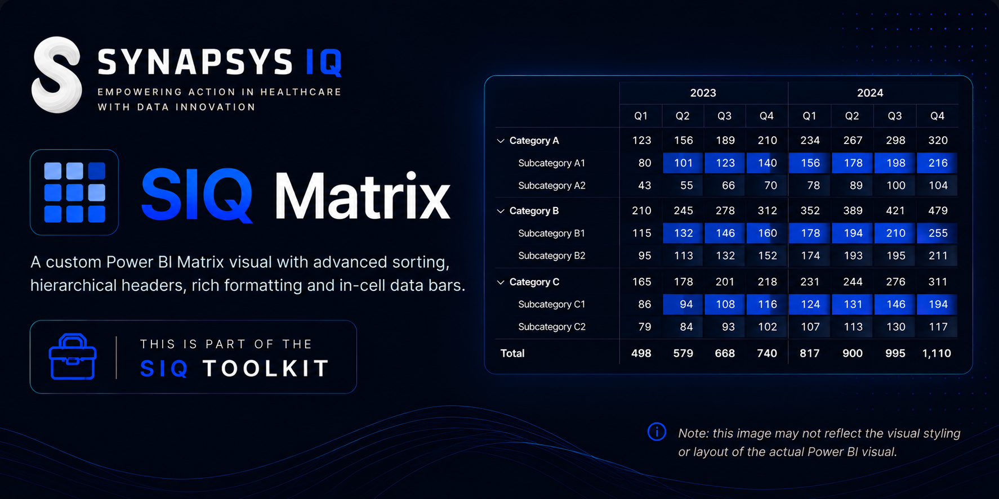

# SIQ Matrix

> A custom Power BI Matrix visual with dynamic column sorting, individual column value sorting, hierarchical headers, rich formatting options, and in-cell data bars.

---

## 📦 Installation

1. Download the latest `SIQ_Matrix.pbiviz` file from the [Releases](https://github.com/gabechisholm/BetterMatrix/releases) page.
2. Open **Power BI Desktop** or **Power BI Service**.
3. In the **Visualizations** pane, click **···** (More options) -> **Import a visual from a file**.
4. Choose the downloaded `.pbiviz` file.

---

## 🗂 Adding Data

Drag fields into the three data roles in the Visualizations pane:

| Role | Description |
|---|---|
| **Rows** | Category fields that form the row hierarchy (supports multiple levels) |
| **Columns** | Category fields that form the column hierarchy (supports multiple levels) |
| **Values** | Numeric measures to display in the cells |

---

## ⚡ Key Sorting Features (How to Sort)

SIQ Matrix supports two independent, powerful sorting modes:

1. **Sort Rows by Individual Column Values** (Click Column Headers):
   * Click on any individual leaf column header (e.g., a specific date or category) to sort all rows based on the values in that column.
   * Click once to sort **Ascending (▲)**, click again for **Descending (▼)**, and click a third time to clear the sort.
   * Click the row header column to sort alphabetically by row labels.
2. **Flip Column Order / Group Sorting** (Header Menu):
   * Click the **…** (Options) button in the visual header bar to flip the chronological/grouping order of the columns themselves (e.g. swap from oldest-first to newest-first).

---

## ✨ Features

* **Hierarchical Headers**: Expand and collapse row/column groups with inline indicators.
* **In-Cell Data Bars**: Visualise magnitude directly inside cells with positive/negative colouring and zero-axis lines.
* **5 Style Presets**: Instantly apply `Default`, `Minimal`, `Bold Header`, `Alternating Rows`, or `Contrast` layouts.
* **Specific Column Overrides**: Override font color, background color, and text alignment on any column by its index.
* **Built-in Search Controllers**: Independent toggles for row keyword search and value-based query filtering (e.g. `>100`, `<=500`).
* **Blank Row Control**: Toggle whether to show or hide blank/empty data rows.
* **Alternate Row Colors**: Stripe colouring with custom background color picker.
* **Multi-Format Exports**: Export pivoted layout or unpivoted raw summaries to CSV or Excel directly from the UI.

---

## 🎨 Formatting Options

Access the following settings inside the **Format visual** pane:

* **Layout and style presets**: Set the overall look (`Default`, `Minimal`, `Bold Header`, `Alternating Rows`, `Contrast`).
* **Grid**: Toggle horizontal/vertical gridlines, configure line weight/color, separator styling, and adjust row padding.
* **Values**: Adjust font family, size, colors, alignments, and set numeric display units and decimal places.
* **Column & Row Headers**: Adjust typography, custom header labels, stepped layout indent depth, and expand/collapse icon colors.
* **Column & Row Grand Totals**: Toggle subtotals/totals, change position (left/right/top/bottom), customize labels, and format fonts and colors.
* **Cell elements**: Configure positive/negative data bar colors and zero-axis lines.
* **Row Search**: Style the search inputs, background, border colors, text size, and adjust layout offsets.

---

## 🏢 Author

Made by **Gabe Chisholm** at [SynapsysIQ](mailto:gabe.chisholm@synapsysiq.co.uk)

---

## 📄 License

MIT
